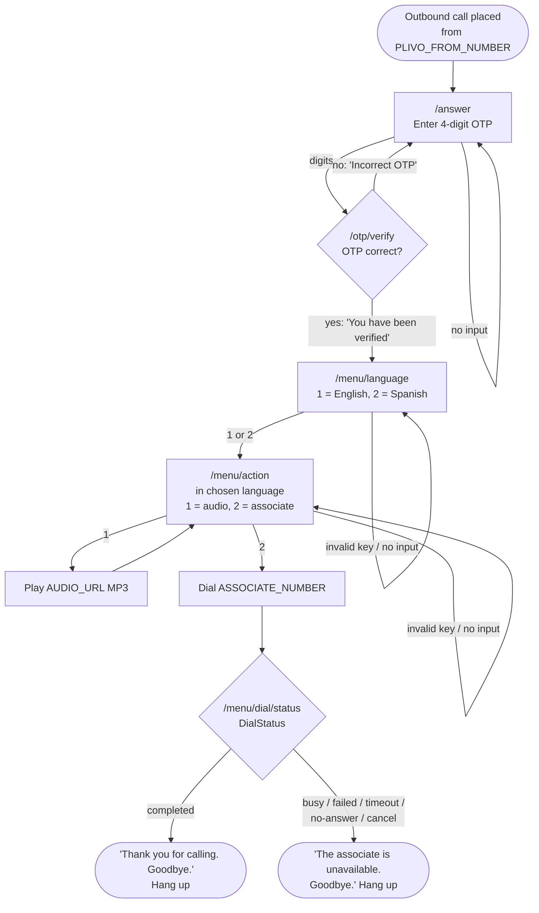

# Plivo IVR Demo

A Flask app that places an outbound phone call through the [Plivo](https://www.plivo.com/) Voice API and runs a multi-level IVR driven entirely by Plivo XML. When the call is answered, the caller must enter a 4-digit OTP (their birthdate as DDMM) via the keypad. A wrong OTP re-prompts; the correct one unlocks a Level 1 language menu (English or Spanish). Level 2, spoken in the chosen language, lets the caller either hear a publicly hosted MP3 or be forwarded to a live associate. Invalid keys and timeouts repeat the current menu. Calls can be triggered from a small local web page or a CLI script.

## Call flow



Menus are reachable only after the correct OTP on the same call; a request for any menu without it is redirected back to the OTP prompt.

## Tech stack

- **Python 3.10+, Flask** — web server for the trigger page, the `/call` API, and the Plivo XML webhooks
- **Plivo Python SDK** — `RestClient.calls.create` for the outbound call; `plivo.plivoxml` to build every XML response (`GetInput`, `Speak`, `Play`, `Dial`, `Redirect`, `Hangup`)
- **python-dotenv** — loads configuration from `.env`
- **pytest, pytest-cov** — test suite; the Plivo client is mocked, so tests never touch the network
- **ngrok** — exposes the local server so Plivo can fetch the webhooks

## Project structure

```
plivo-ivr-demo/
├── app/
│   ├── __init__.py          # Flask app factory: create_app()
│   ├── config.py            # Env var loading, BIRTHDATE_OTP, required-config check
│   ├── plivo_client.py      # make_outbound_call(): E.164 validation, Plivo API call, error wrapping
│   ├── call_state.py        # In-memory, thread-safe per-call state (authenticated + language)
│   ├── prompts.py           # All spoken text and Speak voice/language, keyed by language
│   ├── security.py          # local_only guard for the call trigger
│   ├── routes/
│   │   ├── __init__.py      # Blueprint + GET /health
│   │   ├── calls.py         # GET / (web UI) and POST /call
│   │   └── ivr.py           # Plivo XML webhooks: OTP, menus, Dial status, hangup
│   └── templates/
│       └── index.html       # Self-contained call trigger page (no external dependencies)
├── scripts/
│   └── make_call.py         # CLI: place a call
├── tests/                   # pytest suite (test names carry requirement IDs, e.g. test_r5_...)
├── docs/
│   ├── REQUIREMENTS.md      # Requirements traceability: R1–R18 → tests / manual steps
│   ├── DEMO_SCRIPT.md       # 3–5 minute demo video script
│   └── SUBMISSION_EMAIL.md  # Submission email draft
├── run.py                   # Dev server on port 5000 (loads .env)
├── requirements.txt
├── pytest.ini
└── .env.example             # Template for .env (placeholders only)
```

## Prerequisites

- **Python 3.10+**
- **A Plivo account** with a voice-capable Plivo phone number. On a trial account, Plivo only calls verified numbers: add the target phone and the associate phone under **Phone Numbers → Sandbox Numbers** in the console first.
- **ngrok** ([download](https://ngrok.com/download)) with a free account and authtoken configured (`ngrok config add-authtoken <token>`)

## Configuration

All configuration comes from environment variables, loaded from a `.env` file in the project root. Copy `.env.example` to `.env` and fill in your own values. `.env` is git-ignored and must never be committed.

### Required Plivo credentials

- **`PLIVO_AUTH_ID`** and **`PLIVO_AUTH_TOKEN`** authenticate the app to the Plivo REST API. Find both on the Plivo console home page ([console.plivo.com](https://console.plivo.com/), **Overview / Dashboard**, "Account Info" card). The Auth Token is a secret: keep it only in `.env`. The app never prints or logs it, and API error messages have it redacted.

### All variables

| Variable | Required | Purpose | Example format |
|----------|----------|---------|----------------|
| `PLIVO_AUTH_ID` | Yes | Plivo account Auth ID | `MAXXXXXXXXXXXXXXXXXX` |
| `PLIVO_AUTH_TOKEN` | Yes | Plivo account Auth Token (secret) | `your_auth_token` |
| `PLIVO_FROM_NUMBER` | Yes | Your Plivo number; the caller ID for the outbound call and for the associate transfer | `+91XXXXXXXXXX` |
| `TARGET_NUMBER` | For the CLI default | Number to call; pre-fills the web UI and is the CLI default (overridable with `--to` or in the UI) | `+91XXXXXXXXXX` |
| `ASSOCIATE_NUMBER` | For option 2 | Live associate that Level 2 option 2 forwards to | `+91XXXXXXXXXX` |
| `PUBLIC_BASE_URL` | Yes | Public https URL of this server (your ngrok URL); webhook URLs are built from it | `https://abcd-1234.ngrok-free.app` |
| `AUDIO_URL` | No | Public MP3 for Level 2 option 1; defaults to Plivo's sample `https://s3.amazonaws.com/plivocloud/music.mp3` | `https://example.com/message.mp3` |

All phone numbers use E.164 format: `+`, country code, number. If a required value is missing, the app still starts, but placing a call fails with a clear error naming the missing variables.

### The OTP

The OTP is the birthdate in **DDMM** format, hardcoded as `BIRTHDATE_OTP` in [`app/config.py`](app/config.py), as the assignment requires. It is compared in constant time, never spoken, and never logged.

**To test with your own OTP:** edit `BIRTHDATE_OTP` in `app/config.py` to any valid 4-digit DDMM value (for example `"2512"` for 25 December) and restart the server. The test suite reads the value from config, so it passes with any valid DDMM value.

## Setup

### 1. Clone and install

**Windows (PowerShell)**
```powershell
git clone <repo-url>
cd plivo-ivr-demo
python -m venv .venv
.venv\Scripts\Activate.ps1
pip install -r requirements.txt
Copy-Item .env.example .env
```

**macOS / Linux**
```bash
git clone <repo-url>
cd plivo-ivr-demo
python3 -m venv .venv
source .venv/bin/activate
pip install -r requirements.txt
cp .env.example .env
```

Then open `.env` and set your Plivo credentials and phone numbers.

### 2. Start ngrok and set `PUBLIC_BASE_URL`

In a separate terminal:
```bash
ngrok http 5000
```
Copy the `https://…ngrok-free.app` forwarding URL into `PUBLIC_BASE_URL` in `.env`. On the free plan this URL changes every time ngrok restarts, so update `.env` (and restart the server) whenever it does.

### 3. Run the server

With the virtual env active:
```bash
python run.py
```
The server listens on port 5000. Check it with `curl http://127.0.0.1:5000/health`, which returns `{"status": "ok"}`.

## Running a call

**Web UI:** open **http://127.0.0.1:5000**, check the pre-filled number, and click **Start Call**. The page shows Plivo's `request_uuid` on success or the API's error message on failure.

**CLI** (virtual env active, server and ngrok running so Plivo can reach the webhooks):
```bash
python scripts/make_call.py                    # calls TARGET_NUMBER
python scripts/make_call.py --to +91XXXXXXXXXX # calls another number
```

**API:** `POST http://127.0.0.1:5000/call` with an optional JSON body `{"to": "+91XXXXXXXXXX"}`. It returns `200 {"status": "initiated", "request_uuid": ...}`, `400` for an invalid number, `500` for missing configuration, and `502` if the Plivo API call fails.

## Testing

```bash
pytest -v                                   # full suite
pytest --cov=app --cov-report=term-missing  # with coverage
```

The suite has 135 tests at 99% line coverage. It mocks `plivo.RestClient` in every test, so it needs no credentials or network. It covers:

- **Outbound call:** parameters, URLs, E.164 validation, and error mapping
- **OTP:** prompt, correct and wrong input, unlimited retries, per-call auth, and that the OTP never appears in XML or logs
- **Menus:** both levels in English and Spanish, audio playback, Dial and Dial status, invalid keys and timeouts at every level, and a simulated full call
- **Web UI:** rendering and the absence of secrets
- **Access control:** the local-only call trigger versus the public webhooks

Test names carry requirement IDs, and [`docs/REQUIREMENTS.md`](docs/REQUIREMENTS.md) maps every requirement (R1–R18) to its tests or manual steps.

## Manual end-to-end test

With the server and ngrok running and `PUBLIC_BASE_URL` current:

| # | Action | Expected |
|---|--------|----------|
| 1 | Click **Start Call** at http://127.0.0.1:5000 | UI shows a request UUID; the target phone rings |
| 2 | Answer | "Welcome to the InspireWorks demo. Please enter your 4-digit OTP." |
| 3 | Stay silent ~10 s | "We did not receive any input." and the OTP prompt repeats |
| 4 | Enter a wrong 4-digit OTP | "Incorrect OTP. Please try again." and the OTP prompt repeats |
| 5 | Enter the correct OTP | "Thank you. You have been verified." |
| 6 | Hear Level 1 | "For English, press 1." then, in a Spanish voice, "Para español, presione 2." |
| 7 | Press **9** | "Invalid option." and Level 1 repeats |
| 8 | Press **1** | "Press 1 to hear a short audio message. Press 2 to speak with a live associate." |
| 9 | Press **1** | The MP3 plays, then the Level 2 menu returns |
| 10 | Press **2** | "Connecting you to an associate." and the associate's phone rings, showing your Plivo number |
| 11a | Associate answers, talks, hangs up | Caller hears "Thank you for calling. Goodbye." and the call ends |
| 11b | Associate declines or doesn't answer within 30 s | Caller hears "The associate is unavailable. Goodbye." and the call ends |
| 12 | Place a second call; at Level 1 press **2** | Level 2 is spoken in Spanish: "Presione 1 para escuchar un mensaje de audio. Presione 2 para hablar con un asociado." |

## Endpoints

| Route | Method | Called by | Purpose |
|-------|--------|-----------|---------|
| `/` | GET | Browser (local only) | Call trigger web page |
| `/call` | POST | Web page, curl (local only) | Place an outbound call; optional JSON `{"to": "+…"}` |
| `/health` | GET | Anyone | Liveness check: `{"status": "ok"}` |
| `/answer` | POST | Plivo (answer URL, redirects) | OTP prompt (`GetInput`, DTMF, 4 digits) |
| `/otp/verify` | POST | Plivo (`GetInput` action) | Check OTP; go to Level 1 or re-prompt |
| `/menu/language` | POST | Plivo (redirect) | Level 1 language menu (requires OTP) |
| `/menu/language/select` | POST | Plivo (`GetInput` action) | Store language; go to Level 2 or repeat Level 1 |
| `/menu/action` | POST | Plivo (redirect) | Level 2 menu in the chosen language (requires OTP and language) |
| `/menu/action/select` | POST | Plivo (`GetInput` action) | Play the MP3, dial the associate, or repeat Level 2 |
| `/menu/dial/status` | POST | Plivo (`Dial` action) | Closing message based on `DialStatus` |
| `/hangup` | POST | Plivo (hangup URL) | Log the call result and clear the call's state |

## Design decisions and security notes

- **Plivo XML everywhere.** Every webhook returns XML built with `plivo.plivoxml` (`application/xml`). All `action` and `Redirect` URLs are absolute and built from `PUBLIC_BASE_URL`.
- **Per-call state in memory.** `app/call_state.py` keeps, per Plivo `CallUUID`, whether the OTP was verified and which language was chosen. A lock guards it, and `/hangup` clears it. This is demo-grade by design: a single process, no database.
- **OTP gate.** Every menu route checks the call's authenticated state, so a menu can't be reached by skipping the OTP or by reusing another call's session.
- **Constant-time OTP check.** Input must be exactly 4 ASCII digits and is compared with `hmac.compare_digest`. The OTP value is never spoken, never logged, and never appears in any response. Logs record only "correct" or "incorrect" with the `CallUUID`.
- **No secrets in output.** The Auth Token is redacted from Plivo error messages and logs. The web page never contains the OTP or credentials.
- **Call trigger restricted to localhost.** ngrok makes every route public, so anyone with the URL could otherwise place calls billed to your account. `GET /` and `POST /call` therefore return `403` for:
  - requests carrying `X-Forwarded-For`, which ngrok adds
  - requests from a non-loopback address
  - cross-site browser requests, detected by a mismatched `Origin`
- **Webhooks stay public.** Plivo must reach `/answer`, `/otp/verify`, `/menu/*` and `/hangup` through ngrok, so these routes are not restricted.
- **Accurate call ending.** The associate `Dial` has an `action` URL, so the closing message depends on Plivo's `DialStatus`: a completed call says goodbye, and any other outcome says the associate is unavailable.

## Limitations and future improvements

- **No Plivo signature validation.** The webhooks don't verify the `X-Plivo-Signature-V3` header, so anyone who knows the ngrok URL can send fake webhook requests. They still can't place calls or skip the OTP for a real call.
- **Volatile state.** In-memory call state is lost on restart and isn't shared across processes. A production deployment would use Redis or a database.
- **Unlimited OTP retries.** The assignment requires them. Production would add a retry limit or lockout, plus a per-user OTP instead of a hardcoded one.
- **Development server.** `run.py` uses Flask's development server. Production would run behind a WSGI server such as gunicorn or waitress, with debug off.
- **Unpinned dependencies.** `requirements.txt` lists packages without version pins. The suite was verified with Flask 3.1.3, plivo 4.63.0, python-dotenv 1.2.4, pytest 9.1.1 and pytest-cov 7.1.0.
- **ngrok URL changes.** Free ngrok URLs change on every restart and `PUBLIC_BASE_URL` must be updated to match. A reserved domain or a deployed host would remove this step.
